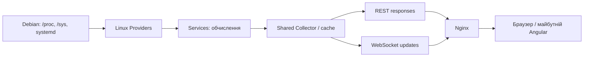

# NodeXora API

Навчальний backend для моніторингу Debian-сервера: Node.js, TypeScript і Fastify.
API читає показники Linux, повертає їх через HTTP та надсилає оновлення через WebSocket.
Цей README — основний путівник по коду, запуску й щоденній роботі із сервером.

## Зміст

- [Швидкий старт](#quick-start)
- [Структура проєкту: де що лежить](#structure)
- [Архітектура: як проходять дані](#architecture)
- [Локальна розробка та команди npm](#development)
- [HTTP API та Swagger](#http-api)
- [WebSocket: як отримувати оновлення](#websocket)
- [Як підключитися до Debian](#ssh)
- [Командник: статус API](#service-status)
- [Командник: журнали та помилки](#logs)
- [Командник: показники сервера](#server-metrics)
- [Керування сервісом](#service-control)
- [Оновлення API та перевірки](#deployment)
- [Як шукати проблему](#troubleshooting)
- [Інші документи проєкту](#documentation)

<a id="quick-start"></a>

## Швидкий старт

**Локальний запуск на Windows — PowerShell:**

```powershell
cd D:\code\node_xora\apps\api
npm ci
$env:SYSTEM_PROVIDER = 'mock'
npm run dev
```

Відкрий [локальний Swagger](http://127.0.0.1:3000/api/) або
[локальний health](http://127.0.0.1:3000/api/v1/health).
`mock` повертає навчальні дані з позначкою `source: mock`, а не показники Debian.
`Ctrl+C` у цьому терміналі зупиняє локальний API.

**Поточний Debian-сервер:**

| Що відкрити                       | Адреса                                                        |
| --------------------------------- | ------------------------------------------------------------- |
| Swagger UI                        | [http://192.168.1.33/api/](http://192.168.1.33/api/)          |
| Перевірка працездатності API      | [health](http://192.168.1.33/api/v1/health)                   |
| RAM у JSON                        | [system/memory](http://192.168.1.33/api/v1/system/memory)     |
| Спільний snapshot усіх ресурсів   | [metrics/current](http://192.168.1.33/api/v1/metrics/current) |
| WebSocket для програмного клієнта | `ws://192.168.1.33/api/v1/ws`                                 |

На сервері API працює як user service `nodexora-api.service` користувача `dvor`.
Звичайний доступ — через Nginx у локальній мережі. Application login і токени зараз не потрібні.

<a id="structure"></a>

## Структура проєкту: де що лежить

`apps/api` — самостійний npm-проєкт. Його залежності, scripts і lockfile знаходяться тут.
Спільного npm workspace або `packages/shared` немає. Angular у `apps/web` — окрема частина.

```text
apps/api/
├── src/
│   ├── server.ts                  # Запуск і завершення процесу
│   ├── app.ts                     # Збирання Fastify та підключення модулів
│   ├── config/                    # Runtime configuration і limits моніторингу
│   ├── common/                    # Спільні типи, schemas та помилки
│   ├── hooks/                     # Спільна HTTP-поведінка, зокрема no-store
│   ├── plugins/                   # Swagger і централізований error handler
│   ├── infrastructure/linux/      # Читання Linux та mock sources
│   ├── modules/
│   │   ├── health/                # Liveness API
│   │   ├── system/                # Host info, RAM, swap, CPU, disk, sensors, sessions
│   │   ├── metrics/               # Collector, shared snapshots і history
│   │   ├── network/               # Інтерфейси, трафік і connections
│   │   ├── processes/             # Процеси, сортування, фільтри й pagination
│   │   ├── services/              # Стани systemd services
│   │   ├── routing/               # IPv4/IPv6 routes
│   │   └── logs/                  # Код читання журналу NodeXora
│   └── realtime/                  # WebSocket, subscriptions, heartbeat, live logs
├── tests/                         # Parser, service, HTTP, collector і WS tests
├── deployment/
│   ├── README.md                  # Пояснення operational files і команд
│   ├── update/                    # Звичайний deploy
│   ├── setup/                     # Налаштування нового сервера
│   └── checks/                    # Linux та LAN verification
├── package.json                   # Залежності й npm commands
├── package-lock.json              # Зафіксовані версії залежностей
├── tsconfig.json                  # Перевірка TypeScript
├── tsconfig.build.json            # Збірка src у dist
├── .prettierrc.json                # Локальні правила Prettier
├── .editorconfig                  # Відступи, encoding і переноси рядків
├── .gitignore                     # Ignore rules, включно з винятком source logs
├── .gitattributes                 # LF для коду та deployment files
├── AGENTS.md                      # Правила роботи з API
├── MONITORING_CONTRACTS.md         # Дані, quality, limits і WS protocol
└── MONITORING_PLAN.md              # План, фактичні результати та залишені роботи
```

`node_modules/` створюється через `npm ci`, а `dist/` — через `npm run build`.
Це згенеровані робочі папки; їхні файли не редагують вручну.

### Відповідальність файлів у модулі

| Файл                                 | Що в ньому знаходиться                                        |
| ------------------------------------ | ------------------------------------------------------------- |
| `*.routes.ts`                        | HTTP method/path, підключення schema і handler                |
| `*.schema.ts` або `schemas/`         | Валідація, response shape, опис полів і Swagger metadata      |
| `*.controller.ts`                    | Отримання HTTP-запиту та формування відповіді                 |
| `*.service.ts`                       | Обчислення, фільтрація, pagination та робота зі sources/cache |
| `*.types.ts`                         | TypeScript типи даних модуля                                  |
| `infrastructure/linux/*.provider.ts` | Читання Linux-файлів та системних interfaces                  |

Маленький health endpoint не потребує окремих controller/service.
Шари додаються там, де мають реальну роботу.

### Джерела Linux-даних

| Provider                  | Джерело або призначення                                           |
| ------------------------- | ----------------------------------------------------------------- |
| `system.provider.ts`      | RAM/swap із `/proc/meminfo`                                       |
| `cpu.provider.ts`         | CPU counters із `/proc/stat` і boot identity                      |
| `host.provider.ts`        | Hostname, `/etc/os-release`, CPU metadata, uptime і load          |
| `hardware.provider.ts`    | Capacity `/` через statfs, temperature через hwmon                |
| `network.provider.ts`     | iproute2, `/proc/net/dev`, TCP/UDP sockets і routes               |
| `processes.provider.ts`   | Bounded scan `/proc`, process identity, UID і RSS                 |
| `activity.provider.ts`    | Systemd services та logind login sessions                         |
| `journal.provider.ts`     | Читання й live-follow журналу NodeXora                            |
| `monitoring.provider.ts`  | Поєднання sources/services у collector tasks; Linux/mock варіанти |
| `mock-system.provider.ts` | Позначені mock RAM/swap дані для локальної розробки               |
| `read-command.ts`         | Запуск fixed executable/argv з timeout та output limit            |

<a id="architecture"></a>

## Архітектура: як проходять дані

Backend має окремі частини для HTTP, обчислень і доступу до Linux.
Основний поділ: **Route → Controller → Service → Provider**.

Для часто оновлюваних показників provider не читається заново на кожен GET.
Спільний collector регулярно збирає результати й тримає останні samples у пам'яті.

Шлях готових показників:



- [server.ts](src/server.ts) читає configuration, обирає Linux/mock sources і запускає listener.
- [app.ts](src/app.ts) підключає routes, plugins, collector, WS та shutdown hooks.
- [collector.service.ts](src/modules/metrics/collector.service.ts) планує shared collection,
  ізолює помилки ресурсів, зберігає samples та bounded history.
- [monitoring.provider.ts](src/infrastructure/linux/monitoring.provider.ts) готує collector tasks,
  використовуючи providers і services.
- [ws.gateway.ts](src/realtime/ws.gateway.ts) приймає subscriptions і передає результати клієнтам.

Наприклад, GET RAM проходить через [system.routes.ts](src/modules/system/system.routes.ts),
[controller](src/modules/system/system.controller.ts) і [service](src/modules/system/system.service.ts).
У звичайному запуску service повертає RAM зі shared cache. Саме читання `/proc/meminfo`
виконується provider під час collection. REST і WS використовують той самий sample.

Поточні інтервали: CPU/RAM/swap/load/uptime/network — 2 s; processes/sessions — 3 s;
host info/disk/sensors/connections/services/routes — 10 s. Налаштування:
[config/monitoring.ts](src/config/monitoring.ts).

Після старту CPU й rates потребують двох samples. Стан `warming_up` та значення `null`
у цей момент очікувані. Помилка окремого ресурсу не повинна приховувати всі інші.

History зберігає до 15 хвилин вибраних series у пам'яті та очищається після restart API.
Вона не створює дані за час до запуску. Ресурси читаються незалежно, не атомарно.

<a id="development"></a>

## Локальна розробка та команди npm

Потрібні Node.js **26.x**, npm і Git. Команди npm виконуй із `apps/api`.
Prettier уже є в локальних devDependencies; глобально встановлювати його не потрібно.

### Запуск на Windows

PowerShell:

```powershell
cd D:\code\node_xora\apps\api
npm ci
$env:SYSTEM_PROVIDER = 'mock'
npm run dev
```

У Git Bash environment задається інакше:

```bash
cd /d/code/node_xora/apps/api
npm ci
SYSTEM_PROVIDER=mock npm run dev
```

`npm run dev` автоматично перезапускає процес при змінах коду.
Для запуску compiled JavaScript у тій самій PowerShell-сесії з `SYSTEM_PROVIDER=mock`:

```powershell
npm run build
npm start
```

Linux provider читає Debian-джерела. Mock-перевірка на Windows не підтверджує
правильність інтеграції з Linux.

### Щоденні npm-команди

| Команда                | Що робить                                                          |
| ---------------------- | ------------------------------------------------------------------ |
| `npm ci`               | Встановлює залежності за lockfile; замінює наявний node_modules    |
| `npm run dev`          | Запускає source API через tsx watch                                |
| `npm run format`       | Форматує TS, checks/*.mjs і API-local JSON                         |
| `npm run format:check` | Перевіряє форматування, не переписуючи файли                       |
| `npm run check`        | Перевіряє типи та невикористані locals/parameters                  |
| `npm test`             | Запускає наявні автоматичні тести, включно з локальними WS sockets |
| `npm run build`        | Збирає TypeScript у dist                                           |
| `npm start`            | Запускає dist/server.js; потребує попереднього build               |

Звичайна перевірка перед commit:

```bash
npm run format
npm run format:check
npm run build
npm run check
npm test
```

Тести запускаємо після кожної логічної групи code-змін. Помилки команд потрібно
виправляти до наступного кроку або commit.

### Форматування та configuration

`.prettierrc.json` і `.editorconfig`: 2 пробіли, single quotes, semicolons, LF,
ширина рядка 100. Між функціями/методами та логічними блоками залишаємо порожній рядок.
Prettier зберігає ці розділення, але автоматично не додає їх.

| Runtime setting   | Значення                            |
| ----------------- | ----------------------------------- |
| `SYSTEM_PROVIDER` | `linux` або `mock`; default `linux` |
| `PORT`            | Число 1–65535; default 3000         |
| Host              | `127.0.0.1`, зафіксований у config  |

Systemd unit на Debian вже задає `SYSTEM_PROVIDER=linux` і `PORT=3000`.
Окремий `.env` файл для поточного запуску не потрібний і не завантажується автоматично.

<a id="http-api"></a>

## HTTP API та Swagger

Swagger UI — [http://192.168.1.33/api/](http://192.168.1.33/api/).
OpenAPI — [JSON](http://192.168.1.33/api/json) або [YAML](http://192.168.1.33/api/yaml).
У Swagger відкрий endpoint → **Try it out** → **Execute**.

Локально ті самі paths доступні на `http://127.0.0.1:3000`.
OpenAPI генерується з Fastify schemas; окрему ручну копію контракту не підтримуємо.

Усі наведені HTTP methods — **GET**, prefix — `/api/v1`:

| Path                                      | Що повертає                                                       |
| ----------------------------------------- | ----------------------------------------------------------------- |
| `/health`                                 | Liveness API; не перевіряє доступність усіх Linux providers       |
| `/system/info`                            | Hostname, OS, kernel, architecture, CPU metadata                  |
| `/system/memory`                          | RAM: total/available/used bytes, percent, timestamp, source       |
| `/system/swap`                            | Swap, enabled; за вимкненого swap percent=null                    |
| `/system/uptime`                          | Uptime seconds, boot time та boot identity                        |
| `/system/load`                            | Load Average за 1/5/15 хвилин; це не CPU%                         |
| `/system/cpu`                             | Total/per-core CPU% і measurement window                          |
| `/system/disks`                           | Capacity кореневого filesystem `/`                                |
| `/system/temperature`                     | Доступні sensors, labels, Celsius та причини недоступності        |
| `/system/sessions`                        | Debian login sessions і окремий count унікальних UID              |
| `/network/interfaces`, `/network/traffic` | Addresses, current address, counters і RX/TX rates                |
| `/network/connections`                    | Bounded TCP/UDP sockets без PID mapping                           |
| `/processes`                              | Фільтрований/відсортований process snapshot із pagination         |
| `/services`                               | Loaded system та поточного user services; running count           |
| `/services/:name?scope=user`              | Деталі відомого unit; scope=user або system                       |
| `/routing/routes`                         | IPv4/IPv6 routes і multipath next hops                            |
| `/logs`                                   | Bounded записи лише user journal сервісу NodeXora                 |
| `/metrics/current`                        | Спільний snapshot, per-section quality та runtime diagnostics API |
| `/metrics/history`                        | Обмежений діапазон уже зібраної history                           |

Успіх має envelope `{ "data": ... }`, помилка — `{ "error": { "code": ..., "message": ... } }`.
RAM/swap і host endpoints повертають DTO безпосередньо в data. Нові sampled endpoints
повертають Sample у data; його data містить показники, а quality/reason описують стан.
Не всі HTTP 200 означають доступний показник: перевіряй quality.

`0` — справжній нуль, `null` — відсутнє або незастосовне значення.
`collectedAt` — час collection, а не відкриття сторінки. Повторний GET може повернути
той самий sample із тим самим timestamp. Відомості про fields, units, limits,
quality та cursor errors — у [MONITORING_CONTRACTS.md](MONITORING_CONTRACTS.md).

<a id="websocket"></a>

## WebSocket: як отримувати оновлення

WebSocket уже реалізований у backend. Angular, який його відображатиме, є окремою роботою.
Адреса для підключення клієнта:

```text
ws://192.168.1.33/api/v1/ws
```

Це не звичайна вебсторінка. В адресному рядку браузера для одного JSON-виміру
відкривай HTTP endpoint, наприклад `/api/v1/system/memory`.
WebSocket відкриває JavaScript або спеціальний клієнт.

Можна перевірити з JavaScript-консолі браузера на нашій Swagger-сторінці:

```javascript
const socket = new WebSocket('ws://192.168.1.33/api/v1/ws');

socket.addEventListener('open', () => {
  socket.send(
    JSON.stringify({
      type: 'subscribe',
      requestId: 'ram-1',
      topic: 'system.memory',
      intervalSeconds: 5,
    }),
  );
});

socket.addEventListener('message', (event) => {
  console.log(JSON.parse(event.data));
});
```

Отримаєш підтвердження subscribed, поточний snapshot і подальші updates.
Інтервал клієнта може бути 2/5/10/30 s; він не запускає окремий collector.
Підписки на різні topics можуть використовувати одне з'єднання.

Після перевірки закрий його в тій самій консолі:

```javascript
socket.close();
```

Для майбутнього UI: GET можна використати для initial load/history, а WS — для live updates.
Після WS snapshot клієнт застосовує новіші samples, відписується при pause та
підписується заново після reconnect. Докладний protocol v1, topics і правила
узгодження даних — у [контракті](MONITORING_CONTRACTS.md#websocket-protocol-v1).

<a id="ssh"></a>

## Як підключитися до Debian

Наступні команди виконуй **на своєму комп'ютері**, а не всередині сервера.

PowerShell:

```powershell
ssh -i "$env:USERPROFILE\.ssh\id_ed25519_hermes_server" dvor@192.168.1.33
```

Git Bash:

```bash
ssh -i ~/.ssh/id_ed25519_hermes_server dvor@192.168.1.33
```

Після успішного входу ти працюєш у Linux shell сервера як `dvor`.
Усі команди наступних чотирьох секцій виконуються **в цьому SSH-сеансі на Debian**.

| Шлях на сервері                                        | Призначення                                                    |
| ------------------------------------------------------ | -------------------------------------------------------------- |
| `/home/dvor/nodexora/api`                              | Compiled API: dist, package manifests, production node_modules |
| `/home/dvor/.config/systemd/user/nodexora-api.service` | Встановлена конфігурація запуску API                           |
| `/etc/nginx/snippets/nodexora-api.conf`                | Встановлений Nginx HTTP/WS proxy snippet                       |
| Systemd user journal                                   | Записи роботи NodeXora; окремий api.log не створюється         |

Source-код, README й scripts залишаються в локальному repository.
На сервері немає source workspace для редагування або запуску npm tests.
Завершити SSH-сеанс:

```bash
exit
```

<a id="service-status"></a>

## Командник: статус API

**Перші дві команди, коли потрібно перевірити, чи живий API:**

```bash
systemctl --user status nodexora-api.service --no-pager
curl -fsS http://127.0.0.1/api/v1/health
```

Перша показує стан процесу, друга перевіряє HTTP через Nginx.
Окрема перевірка Fastify, оминаючи Nginx:

```bash
curl -fsS http://127.0.0.1:3000/api/v1/health
```

Інші корисні перевірки:

| Команда                                                                                | Для чого                                                        |
| -------------------------------------------------------------------------------------- | --------------------------------------------------------------- |
| `systemctl --user is-active nodexora-api.service`                                      | Чи працює API зараз                                             |
| `systemctl --user is-enabled nodexora-api.service`                                     | Чи зареєстрований автозапуск user service                       |
| `loginctl show-user dvor -p Linger`                                                    | Чи user manager може стартувати без login; очікується yes       |
| `systemctl --user show nodexora-api.service -p MainPID -p ExecMainStatus -p NRestarts` | PID, exit status і лічильник автоматичних рестартів             |
| `systemctl --user cat nodexora-api.service`                                            | Чинна встановлена unit configuration                            |
| `systemctl status nginx --no-pager`                                                    | Стан Nginx                                                      |
| `ss -ltn 'sport = :3000'`                                                              | Listener API; у поточній схемі має бути loopback 127.0.0.1:3000 |

Використовуй `--user` для NodeXora. Nginx — системний service, для нього `--user` не потрібний.
Enabled/linger підтверджують configuration, а реальний автозапуск після reboot
підтверджується лише окремою перевіркою після повернення сервера.

<a id="logs"></a>

## Командник: журнали та помилки

NodeXora пише JSON-повідомлення через Fastify/Pino у stdout, а systemd збирає їх у journal.
`src/modules/logs/` — це source-код читання журналів; самі записи в цій папці не зберігаються.
Тривалість зберігання визначає configuration journald, а не наш API.

### Останні записи

Останні 50 записів NodeXora:

```bash
journalctl --user -u nodexora-api.service -n 50 --no-pager
```

Записи від поточного boot:

```bash
journalctl --user -u nodexora-api.service -b --no-pager
```

Записи за останні 15 хвилин:

```bash
journalctl --user -u nodexora-api.service --since '15 minutes ago' --no-pager
```

### Стежити за журналом наживо

```bash
journalctl --user -u nodexora-api.service -n 30 -f
```

Залиш термінал відкритим і роби запити до API — нові записи з'являтимуться тут.
`Ctrl+C` припиняє лише перегляд журналу, API продовжує працювати.

### Саме помилки застосунку Pino

Pino має власне поле level: warn=40, error=50, fatal=60. Воно знаходиться всередині
JSON message і не тотожне journal priority. Тому `journalctl -p err` не є надійним
фільтром усіх помилок нашого застосунку.

Показати структуровані Pino error/fatal записи за сьогодні, без додаткової залежності jq:

```bash
journalctl --user -u nodexora-api.service --since today -o cat --no-pager |
  ~/.local/bin/node --input-type=module -e '
    import { createInterface } from "node:readline";
    const lines = createInterface({ input: process.stdin });

    for await (const line of lines) {
      try {
        const entry = JSON.parse(line);
        if (typeof entry.level === "number" && entry.level >= 50) console.log(line);
      } catch {}
    }
  '
```

Для live-перегляду заміни `--since today` на `-n 0 -f`.
Цей фільтр показує лише JSON Pino error/fatal; звичайні повідомлення systemd та
HTTP-запити з їхніми response statuses дивись у повному журналі вище.

Окремо записи з journal priority error та серйознішими рівнями:

```bash
journalctl --user -u nodexora-api.service -p err --since today --no-pager
```

### Журнал Nginx та читання через API

Системний journal Nginx (може знадобитися sudo):

```bash
sudo journalctl -u nginx -n 50 --no-pager
```

Системний journal Nginx не замінює його access/error files: їхнє розташування
визначається чинною configuration Nginx.

Останні записи NodeXora через HTTP:

```bash
curl -fsS 'http://127.0.0.1/api/v1/logs?limit=20'
```

Цей endpoint читає тільки user journal `nodexora-api.service` у межах прав `dvor`.
Його query priority також означає journal priority, а не JSON level Pino.

<a id="server-metrics"></a>

## Командник: показники сервера

Ці команди виконуються на Debian після SSH-входу.
Вони показують поточний стан ОС, а не збережені приклади з документації.

| Команда                                                         | Що дивитися                                                    |
| --------------------------------------------------------------- | -------------------------------------------------------------- |
| `uptime`                                                        | Час роботи й load averages                                     |
| `free -h`                                                       | RAM/swap у зручних одиницях                                    |
| `free -b`                                                       | RAM/swap у bytes для порівняння з API                          |
| `df -h /`                                                       | Місткість кореневого filesystem                                |
| `df -B1 /`                                                      | Capacity в bytes; percent може мати інший denominator, ніж API |
| `top`                                                           | Інтерактивний CPU/RAM/process monitor; вихід клавішею q        |
| `ps -eo pid,user,comm,%cpu,%mem,rss --sort=-%cpu \| head -n 16` | Процеси з найбільшим CPU; RSS тут у KiB                        |
| `ip -br address`                                                | Інтерфейси та адреси сервера                                   |
| `ip -s link`                                                    | Накопичені RX/TX counters інтерфейсів                          |
| `ip -4 route`                                                   | IPv4 routes                                                    |
| `ip -6 route`                                                   | IPv6 routes                                                    |
| `ss -ltn`                                                       | TCP listening sockets                                          |
| `ss -tnu`                                                       | TCP/UDP sockets у відповідних станах; не список login users    |
| `loginctl list-sessions`                                        | Сесії входу в Debian                                           |
| `hostnamectl`                                                   | Host/OS/kernel metadata                                        |
| `~/.local/bin/node --version`                                   | Версія Node.js, який використовує наш unit                     |

Якщо встановлено lm-sensors, `sensors` показує temperature readings.
API читає доступні hwmon sensors самостійно; відсутність sensors CLI не означає
відсутність усіх датчиків. Невідоме обладнання не потрібно домислювати за назвами.

`ps %CPU` має іншу часову семантику, ніж delta CPU API. Для точного порівняння
потрібні зіставні measurement windows. Також usable RAM не дорівнює сумі RSS процесів.

### Показники API через HTTP

```bash
curl -fsS http://127.0.0.1/api/v1/system/memory
curl -fsS http://127.0.0.1/api/v1/system/cpu
curl -fsS http://127.0.0.1/api/v1/network/traffic
curl -fsS http://127.0.0.1/api/v1/metrics/current
```

У metrics/current поле runtime містить статистику **самого API-процесу**:
RSS/heap у bytes, накопичений CPU time у microseconds та Event Loop delay у ms.
Це не RAM/CPU всього Debian; машинні показники знаходяться у sections.

Із PowerShell на Windows можна отримати runtime без SSH:

```powershell
(Invoke-RestMethod 'http://192.168.1.33/api/v1/metrics/current').data.runtime | Format-List
```

Для systemd-статистики ресурсу API, якщо облік увімкнений у системі:

```bash
systemctl --user status nodexora-api.service --no-pager
```

Наявні поля CPU/Memory залежать від systemd accounting; відсутні значення не означають нуль.

Стежити наживо лише за процесом запущеного API (вихід клавішею q):

```bash
top -p "$(systemctl --user show nodexora-api.service -p MainPID --value)"
```

<a id="service-control"></a>

## Керування сервісом

Наступні команди **змінюють стан API**. Виконуй їх на Debian після SSH-входу.
Для звичайного оновлення коду використовуй deploy, а не ручний npm start поруч із service.

| Команда                                         | Дія                                        |
| ----------------------------------------------- | ------------------------------------------ |
| `systemctl --user restart nodexora-api.service` | Перезапустити API з поточних runtime files |
| `systemctl --user stop nodexora-api.service`    | Зупинити API                               |
| `systemctl --user start nodexora-api.service`   | Запустити зупинений API                    |

Stop не прибирає enable registration. Restart очищає in-memory history та створює новий streamId.
Якщо unit file справді змінено, перед restart виконується `systemctl --user daemon-reload`.
Рутинний deploy unit file не змінює. Не запускай паралельний API через nohup або npm start.

Для **перевірки** configuration Nginx без застосування змін:

```bash
sudo nginx -t
```

Лише після запланованої зміни configuration й успішного nginx -t її застосовують:

```bash
sudo systemctl reload nginx
```

На поточному сервері unit і Nginx вже встановлені. Відновлення або новий сервер —
окрема процедура в [deployment/README.md](deployment/README.md).

<a id="deployment"></a>

## Оновлення API та перевірки

### Звичайне оновлення

Запускай **локально у Git Bash**, з кореня repository на Windows:

```bash
cd /d/code/node_xora
bash apps/api/deployment/update/deploy.sh
```

Скрипт робить local clean install, type check, tests і fresh build; передає на Debian
лише dist, package.json і package-lock.json; встановлює production dependencies;
виконує Linux preflight, service stop/start і HTTP checks через Nginx.

Потрібні вже встановлені API service, Linger=yes і працюючий Nginx route.
Під час активації є коротка перерва. Якщо активація не вдалася, скрипт намагається
повернути попередню збірку. Наявність скрипта не є доказом успішного deploy — дивись результат запуску.

Deploy не застосовує Nginx configuration, не змінює unit, не потребує sudo й не
копіює source, docs, scripts, локальні environment files чи Windows node_modules у runtime.
Local/server Node.js major мають збігатися. Lifecycle install scripts вимкнені.

Довідка без розгортання:

```bash
bash apps/api/deployment/update/deploy.sh --help
```

### Окремі перевірки

Перевірка REST/WS через LAN із Windows, з кореня repository:

```bash
node apps/api/deployment/checks/verify-lan.mjs
```

Докладна Linux-перевірка й короткий three-client WS сценарій запускаються локально
з Git Bash, а виконуються на Debian через SSH stdin:

```bash
ssh -i ~/.ssh/id_ed25519_hermes_server dvor@192.168.1.33 \
  'cd /home/dvor/nodexora/api && /home/dvor/.local/bin/node --input-type=module' \
  < apps/api/deployment/checks/verify-server.mjs
```

Ці checks не роблять deploy або reboot. Серверна перевірка займає понад 35 секунд,
створює три WS-підключення й звіряє Linux readings із API. Її допуски та development
budgets описані в скрипті й [контракті](MONITORING_CONTRACTS.md).
Перевірку кількома клієнтами на спільному сервері проводь як окрему погоджену дію.

Пояснення всіх файлів update/setup/checks та першого встановлення —
[deployment/README.md](deployment/README.md).

<a id="troubleshooting"></a>

## Як шукати проблему

| Симптом                                 | Що перевірити                                                                |
| --------------------------------------- | ---------------------------------------------------------------------------- |
| Swagger не відкривається                | LAN/SSH-доступ, Nginx status, API status, health через proxy                 |
| Nginx повертає 502                      | Прямий health на 127.0.0.1:3000 та user journal API                          |
| Прямий health працює, proxy health — ні | Nginx configuration, service state і системний journal                       |
| Health ok, а ресурс недоступний         | HTTP status, quality/reason секції, Linux source та права dvor               |
| CPU/rates спочатку null                 | Дочекайся другого collection sample; перевір warming_up                      |
| Process cursor повернув 409             | Snapshot змінився; почни pagination з першої сторінки                        |
| Після restart немає старих графіків     | History лише in-memory; минулі точки не відновлюються                        |
| На Windows Linux readings не працюють   | Для local development обери SYSTEM_PROVIDER=mock                             |
| WebSocket URL не показує JSON у вкладці | Потрібний WS-клієнт і subscribe; для одного JSON використовуй GET            |
| journalctl -p err порожній              | Переглянь повний journal або JSON Pino level; це різні рівні                 |
| Новий source файл не видно в Git        | Перевір git status/check-ignore; src/modules/logs — код і має відстежуватися |

Відсутність зв'язку з API не доводить, що весь Debian вимкнувся.
Поточні read-only endpoints не перезапускають сервіси й не змінюють мережу або файли ОС.

<a id="documentation"></a>

## Інші документи проєкту

| Документ                                                                   | Для чого                                                             |
| -------------------------------------------------------------------------- | -------------------------------------------------------------------- |
| [PROJECT_SPEC.md](../PROJECT_SPEC.md)                                      | Архітектурні рішення та scope проєкту                                |
| [AGENTS.md](AGENTS.md)                                                     | Правила змін API, межі файлів, style та перевірки                    |
| [MONITORING_CONTRACTS.md](MONITORING_CONTRACTS.md)                         | Точні units, fields, quality, limits, history і WS protocol          |
| [MONITORING_PLAN.md](MONITORING_PLAN.md)                                   | Етапи, фактичні попередні перевірки та відкритий frontend-only пункт |
| [deployment/README.md](deployment/README.md)                               | Призначення operational files і команди запуску                      |
| [Windows deployment guide](../README.md)                                   | Докладна інструкція оновлення з Windows                              |
| [nodexora-api-feature](../../.agents/skills/nodexora-api-feature/SKILL.md) | Workflow для наступних backend-змін                                  |

HTTP contracts визначають route schemas та generated OpenAPI. Цей README пояснює
користування й структуру, а докладні правила залишаються у відповідних документах.
Application login/access control, public-IP lookup, persistent history та administration
відкладені. Поточний LAN development API не оголошується production-ready.
